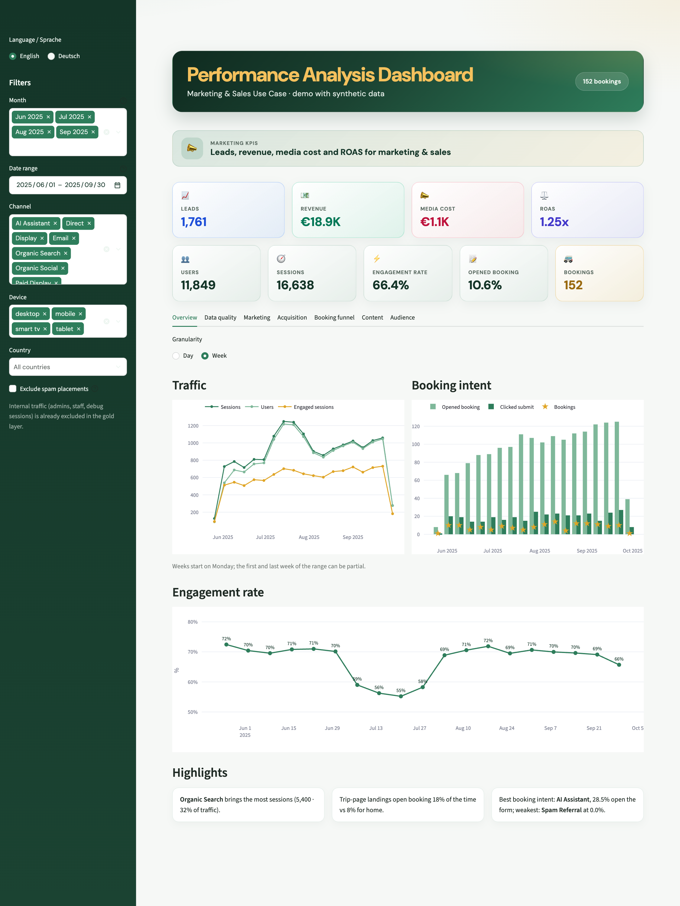
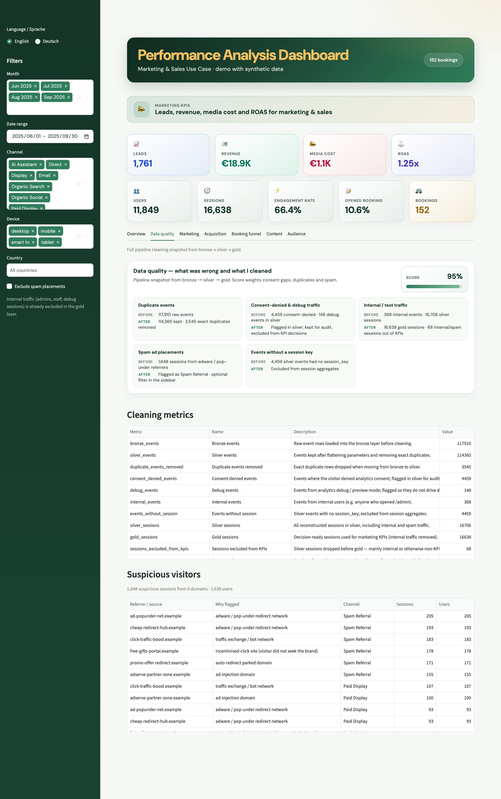
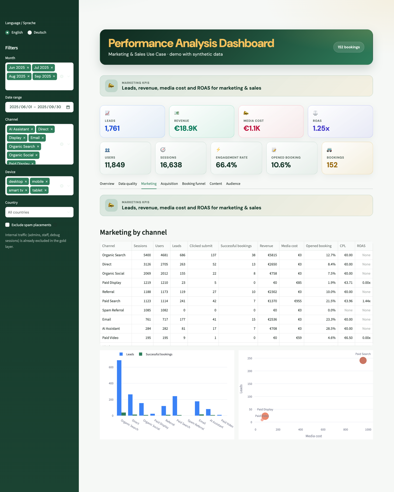
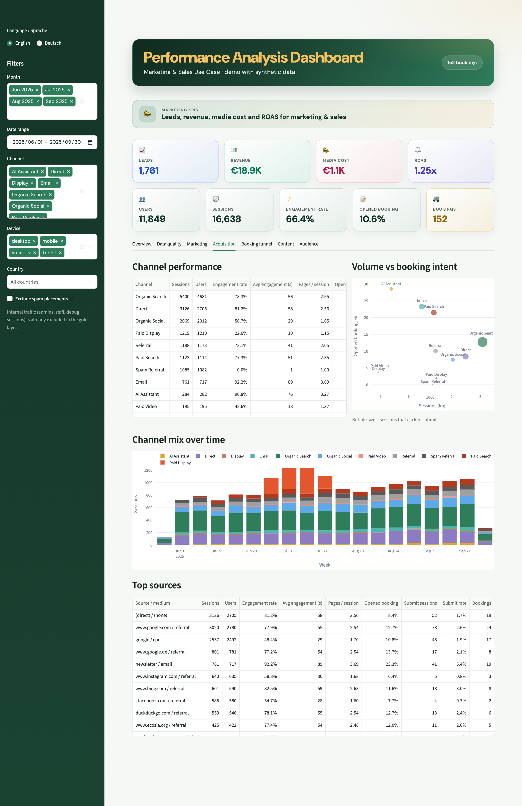
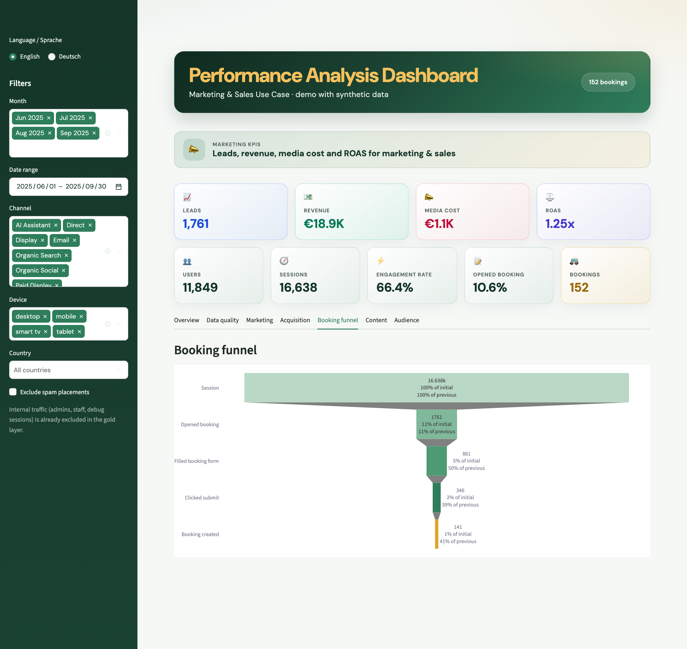
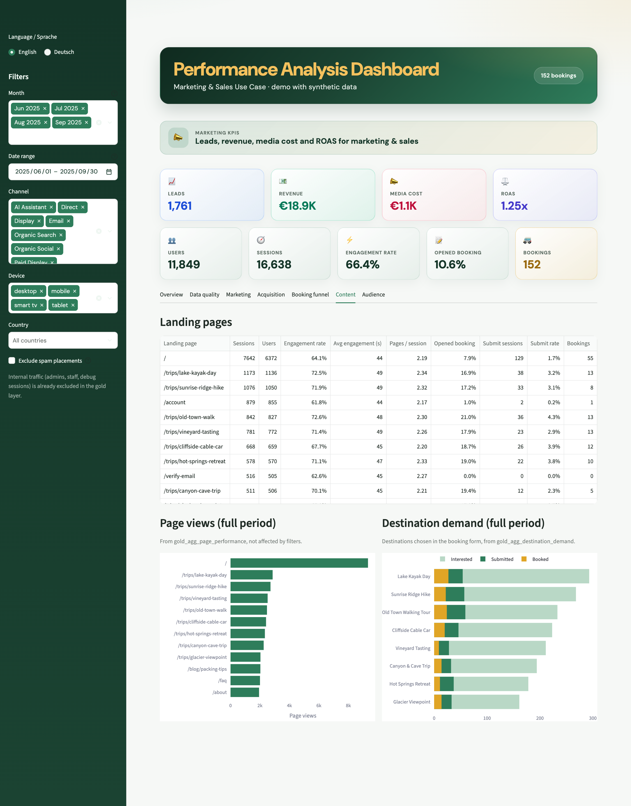
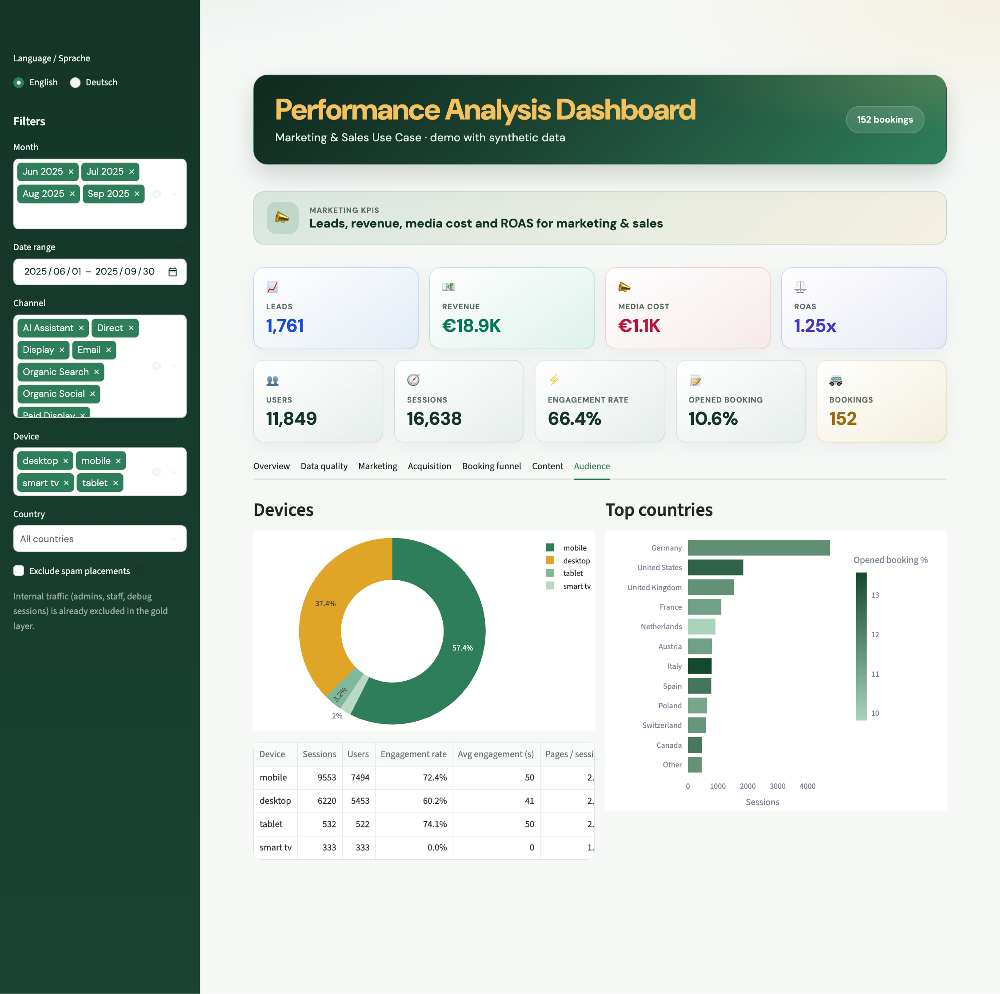
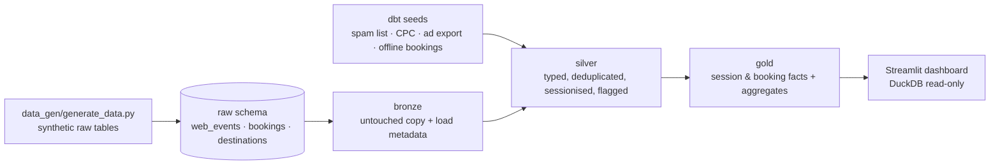

# Performance Analysis Dashboard

An end-to-end **marketing & sales analytics** project: raw web events and bookings are cleaned and modelled with
**dbt** (bronze → silver → gold) on **DuckDB**, and served through an interactive, bilingual (EN/DE) **Streamlit**
dashboard.

> **All data in this repository is synthetic.** The site (`trips.example`), destinations, visitors, prices,
> campaigns and bookings are generated by a seeded script. Nothing here is real customer, traffic or business data.



## What it shows

The project answers the questions a marketing / growth team asks of an online booking business:

- **Where does traffic come from, and does it convert?** A custom channel grouping (organic, paid, AI assistants,
  email, referral, spam, …) built from raw click IDs, UTM parameters and referrers.
- **What do we get for our ad spend?** Leads, revenue, media cost, CPL and **ROAS** per channel, with ROAS
  calculated only on revenue attributed to paid channels.
- **Can we trust the numbers?** A data-quality tab that shows what was wrong in the raw data, what the pipeline
  changed, and a cleanliness score, including the suspicious visitors and the reason each one was flagged.
- **Where do visitors drop out of the booking funnel?** Cumulative funnel from session → opened booking → form →
  submit → booking created.

| Data quality | Marketing |
| --- | --- |
|  |  |

| Acquisition | Booking funnel |
| --- | --- |
|  |  |

| Content | Audience |
| --- | --- |
|  |  |

## Architecture



Everything runs locally in a single DuckDB file, so there are no cloud accounts or credentials to set up.

### Layers

| Layer | Models | What happens |
| --- | --- | --- |
| **bronze** | `bronze_web_events` | Untouched copy of the raw event stream for the reporting window, plus load metadata. |
| **silver** | `silver_events`, `silver_sessions`, `silver_bookings`, `silver_channel_cpc` | Typed columns, URL → `page_path`, exact-duplicate removal, **sessionisation**, traffic attribution, channel grouping, spam / internal / debug / consent flags, price parsing, current-version filtering. |
| **gold** | `gold_fct_sessions`, `gold_fct_bookings`, `gold_agg_*` | Reporting-ready facts and aggregates: daily KPIs, channel performance, booking funnel, page performance, destination demand, marketing KPIs, data-quality snapshot. |

Quality gates: **89 dbt data tests** (not-null / unique / accepted values / ranges / relationships, plus five singular
tests), e.g. *every gold aggregate reconciles to the same session and booking totals*, *a funnel step can never have more
sessions than the step before it*, and *deduplication may only remove re-sent events*.

## Key logic

- **Sessionisation:** `session_key = user_pseudo_id + session_id`. Source / medium are only sent on a session's
  first hits, so the earliest non-null value in the session wins.
- **Channel grouping:** ordered rules, e.g. paid click ID + `gad_source = 1` → *Paid Search*, `= 5` → *Paid
  Display*, paid click + YouTube referrer → *Paid Video*, referrer on the spam list → *Spam Referral*, AI assistant
  sources → *AI Assistant*, then organic search / social / email / direct / referral.
- **Data cleaning:** exact duplicate events (tag re-sends) are removed; consent-denied (cookieless) pings, debug
  traffic and internal users are **flagged, not deleted**, so they remain auditable. Internal sessions and test
  bookings are excluded from KPIs in gold.
- **Cleanliness score:** `100 − (consent-denied share × 40 + duplicate share × 30 + spam-session share × 30)`.
- **Leads:** sessions that opened the booking form.
- **Media cost:** paid-channel sessions × cost per click (from the ad-platform export where available, otherwise an
  assumed CPC seed).
- **ROAS:** revenue from bookings attributed to paid channels ÷ media cost. Organic and offline revenue are
  deliberately not credited to ads.
- **Offline bookings:** a small anonymised seed of chat / phone bookings that never touched the website, so
  revenue reflects demand outside the web funnel.
- **PII:** customer names exist only in the raw booking export and are never carried into silver or gold.

### Story built into the demo data

The synthetic data contains a few realistic problems for the pipeline to find:

- a July **Paid Display** campaign that buys a lot of junk placements (pop-under / traffic-exchange sites):
  engagement dips, sessions spike, media cost is spent and ROAS is 0;
- ~3 % re-sent duplicate events, cookieless consent-denied pings, staff / debug traffic;
- a few percent of bookings that never produced an analytics event, test bookings from staff accounts, edited bookings with
  superseded versions, and free-text prices (`"60"`, `"€45"`, `"75 EUR"`).

## Run it locally

Requires Python 3.10+.

```bash
make setup      # virtualenv + dependencies + dbt packages
make data       # generate synthetic raw data -> dbt seed -> dbt build (models + tests)
make app        # http://localhost:8501
```

Or step by step:

```bash
python3 -m venv .venv && source .venv/bin/activate
pip install -r requirements.txt

python data_gen/generate_data.py          # writes data/warehouse.duckdb (raw schema)
cd dbt
dbt deps  --profiles-dir .
dbt seed  --profiles-dir .
dbt build --profiles-dir .
cd ..

streamlit run dashboard/app.py
```

The generator is deterministic (`--seed 42` by default), so everyone gets the same dataset. Use another seed to
get a different one: `python data_gen/generate_data.py --seed 7`.

## Repository layout

```
data_gen/          synthetic raw data generator (numpy + DuckDB)
dbt/
  models/          bronze / silver / gold models and schema tests
  seeds/           spam referrers, staff accounts, assumed CPC, ad export, offline bookings
  tests/           singular data tests (reconciliation, funnel monotonicity, dedup bounds)
  macros/          schema naming, safe_divide
dashboard/         Streamlit app (app.py, components, EN/DE i18n, CSS theme)
scripts/           screenshot automation (Playwright + local Chrome)
docs/screenshots/  images used in this README
```

## Tech stack

Python · dbt-core + dbt-duckdb · DuckDB · pandas · NumPy · Streamlit · Plotly · Playwright (screenshots).

## License

MIT, see [LICENSE](LICENSE).
